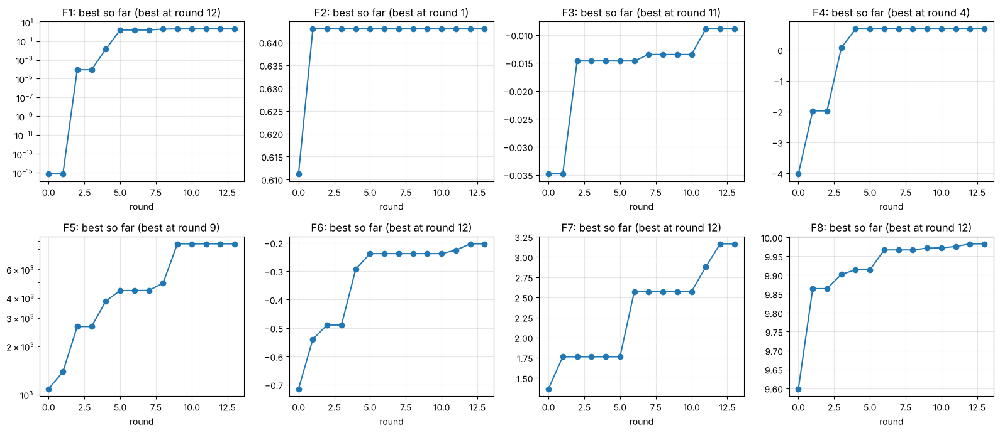

# Black-Box Optimisation Capstone: Imperial ML and AI

Capstone project for the Professional Certificate in Machine Learning and Artificial Intelligence, Imperial College Business School. Thirteen query rounds, Modules 12 to 24 (July to October 2026). This README follows the Module 25 README template; the datasheet and model card are in `docs/`.

## NON-TECHNICAL EXPLANATION OF YOUR PROJECT

I was given eight hidden formulas. Each takes a few numbers in and gives one number back, and the only way to learn about a formula was to try an input and see the result, once a week for thirteen weeks. The aim was to find the input that gives the highest result for each one. My approach was to build a statistical guess of each formula from the results so far, use that guess to choose the next try, and check every week whether the guess was getting things right. Where it was not, I followed the measured readings instead. All eight formulas ended well above their starting best, and the same method applies wherever each experiment is expensive.

## DATA

**Source.** The eight functions and their starting points were supplied by the course through the capstone portal (Module 12). Every input lies in [0, 1]. Queries are submitted as a dash-separated string with each value to six decimal places; 1.000000 is invalid, so 0.999999 is the effective upper bound. One query per function per week; results arrive later in the week, so each round is decided without feedback on the current one.

| Fn | Dim | Starting points | What the course says it represents | Output character |
|---|---|---|---|---|
| 1 | 2 | 10 | locating a radiation source | tiny positives, 200+ orders of magnitude; deterministic |
| 2 | 2 | 10 | a noisy log-likelihood with local optima | 0 to 0.65; noisy, about 0.05 |
| 3 | 3 | 15 | adverse reactions to a three-compound drug (negated) | negative, ceiling 0; noisy |
| 4 | 4 | 30 | warehouse-placement model, four hyperparameters | negative at the start, 0.68 at best; deterministic |
| 5 | 4 | 20 | yield of a chemical process | 0.1 to 8,700, heavily skewed; deterministic |
| 6 | 5 | 20 | cake recipe penalty, five ingredients (negated) | negative, ceiling 0 |
| 7 | 6 | 30 | ML model with six hyperparameters | 0 to 3.2 |
| 8 | 8 | 40 | ML model with eight hyperparameters | 9 to 10, narrow band; deterministic |

**What is in this repository.** The starting points as supplied (`stage2/initial_data/`, small `.npy` files, 175 points in all) and every query I submitted with the value returned (`stage2/query_log.csv`, 104 rows, one per function per round, with a tag recording what chose each query). Nothing is large enough to need external hosting. Full documentation of the data set, following the course datasheet template, is in [docs/datasheet.md](docs/datasheet.md).

## MODEL

A Gaussian process surrogate per function (Matern 2.5 kernel, one length-scale per input), with expected improvement as the acquisition function. I chose it because it is the standard tool when evaluations are expensive and few: it gives a prediction and an uncertainty at any point, and expected improvement turns the two into a single score for where to query next. Around it:

- A log transform of the outputs where they are skewed (functions 1, 5, 7). It is monotone, so the best input is unchanged, but the model is no longer dominated by one extreme reading. On function 1 this was the single most valuable decision in the project: the readings looked like zero on the raw scale and carried a gradient of hundreds of orders of magnitude on the log scale.
- A fitted noise term where readings at nearby inputs disagree (functions 2, 3), which also says how large a difference has to be before it means anything.
- A linear SVM on function 8 that separates the top third of results from the rest, used as a fence so the acquisition only searches inside the region it rates as good. At forty points in eight dimensions no regression model could predict this function; the classifier could.
- A model committee (ridge, nearest neighbours, random forest, gradient boosting, a small neural network) compared by cross-validation on the functions where the GP stalled. Which model validated differed by function, and the one that did chose the local step.

The pipeline is in `stage2/bbo_weekly_analysis.ipynb`, executed end to end on the full history. The model card, following the course template, is [docs/model_card.md](docs/model_card.md).

## HYPERPARAMETER OPTIMISATION

The surrogate's own hyperparameters (kernel amplitude, the per-dimension length-scales, the noise level) are fitted by maximising the marginal likelihood with several optimiser restarts, which is scikit-learn's default route. Three settings were chosen by hand, each because the data forced it: the exploration margin `xi` in expected improvement (0.01 by default, 0.02 on the noisy function 2, 0.03 on functions 4 and 7 where the surface was rough or broad); the length-scale bounds on function 4, tightened from the default to 0.02 to 5 after the default let the GP smooth away a sharp spike; and the top-third threshold of the SVM fence, chosen so that enough points fell on each side to cross-validate.

The decision procedure around the model had three settings of its own, all learned from the query record. A proposal is submitted automatically only if it is stable across five random seeds and its predicted gain over the best point is clearly positive. A function whose forecasts miss repeatedly gets its local steps from the committee or from the measured readings instead. And roughly a sixth of queries (17 of 104) were deliberate explorations, concentrated where the description warned of multiple optima or where a region was unsampled, with none in the last two rounds.

Two rules came out of my own mistakes and are kept because they cost me rounds: a global correlation is not a local gradient (it misled me on functions 3 and 6), and fitted length-scales are unstable at small sample sizes and must be checked across seeds before they are believed (function 7).

## RESULTS

Best value found per function, against the starting data. Every query and result is in `stage2/query_log.csv`; the notebook reproduces this table and the figure in its final section.



| Fn | Dim | Starting best | Best after round 10 | Best found | Round | Final submission | What chose the best query |
|---|---|---|---|---|---|---|---|
| 1 | 2 | 7.7e-16 | 1.980 | 1.998 | 12 | 1.998 | a measured parabola through the last three readings on the log scale |
| 2 | 2 | 0.611 | 0.643 | 0.643 | 1 | 0.641 | GP with expected improvement; never beaten, the noise exceeded any predicted gain |
| 3 | 3 | -0.035 | -0.0135 | -0.0089 | 11 | -0.024 | the GP's local maximum; the function later proved noisy |
| 4 | 4 | -4.03 | 0.682 | 0.682 | 4 | 0.682 | GP with expected improvement |
| 5 | 4 | 1,089 | 8,662 | 8,662 | 9 | 8,662 | following the measured ridge along x1 to the corner of the box |
| 6 | 5 | -0.714 | -0.238 | -0.203 | 12 | -0.343 | the GP's local maximum |
| 7 | 6 | 1.365 | 2.571 | 3.162 | 12 | 3.098 | the GP's local maximum, after a hand step moved x1 off its edge |
| 8 | 8 | 9.598 | 9.972 | 9.983 | 12 | 9.983 | GP with expected improvement |

What the model taught me, function by function. Function 1 was invisible on the raw scale and a single sharp peak on the log scale. Function 2 is a narrow crest, flat along its length, with noise of about 0.05, so the leaderboard spread on it is mostly luck. Function 3 sits close to its ceiling of zero and is noisier than any early fit suggested. Function 4 is rugged at a scale no smooth model captured. Function 5 is monotone to the corner of the box and symmetric in three of its inputs there. Function 6 has at least one better basin that my search never entered. Function 7 had one input that every model proposal left at zero for ten rounds; moving it gave the largest single gain of the challenge. Function 8 is nearly linear along a few directions, which is why a classifier could guide the search before a regression model could.

Of the 104 queries, 61 were chosen by a model, 18 by a step read from the measured values, 17 were deliberate explorations, 3 came from structural hypotheses and 5 were repeats of the best input to test for noise. Of the 40 queries that produced a new best, 32 were model-chosen. Round 11 was the strongest single round, with new bests on five functions at once. The repeats in round 13 showed functions 1, 4, 5 and 8 to be deterministic and function 3 to be noisy.

What I would do differently: look at every function on a log scale before fitting anything; move every input of the best point at least once in the first five rounds; spend one early repeat on any function described as noisy; run the committee from round 1; and in a final round that counts only the last submission, resubmit every best point rather than take a step, since the three steps I took all came back below the best.

## Repository layout

```
README.md
LICENSE                          MIT
docs/
  datasheet.md                   datasheet, course template, all eight functions
  model_card.md                  model card, course template
  best_so_far.png                figure from the notebook's final cell
stage2/
  bbo_weekly_analysis.ipynb      the weekly analysis notebook, full history in section 1, executed
  query_log.csv                  every query and result, 104 rows, with decision tags
  initial_data/function_1..8/    the course-supplied starting points (.npy)
stage1/
  reflections/                   Stage 1 write-ups (Modules 6 to 8)
```

## How to run

```
pip install numpy scipy scikit-learn matplotlib jupyter
cd stage2
jupyter notebook bbo_weekly_analysis.ipynb
```

Run all cells. The notebook reads `initial_data/` and the `ROUNDS` list in section 1; nothing else is needed. To replay an earlier round, shorten `ROUNDS` to the first k entries and run again. A full run takes a few minutes because of the Gaussian process refits.

## Stage 1 context (Modules 3 to 11)

Before the BBO challenge, Stage 1 covered skill-building exercises on a practice data set of my choosing plus the built-in Wine data set. I used Home Credit Default Risk (Kaggle): predicting whether a thin-file loan applicant will repay, from application and credit-history data. Binary classification, imbalanced (defaults around 8 percent), scored on ROC-AUC. That work lives in `stage1/` and is not part of the graded Stage 2 challenge.

## CONTACT DETAILS

Vugar Nasibov, via this repository.
