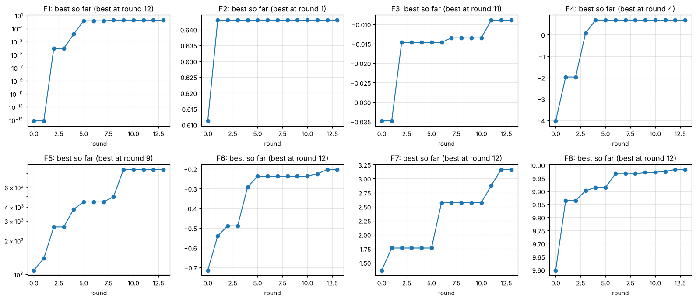

# Model Card: BBO capstone optimiser

This card follows the Module 25 model card template (Model Description, Performance, Limitations, Trade-offs) and finalises the card I wrote for component 21.2. The "model" is the decision procedure I used to choose one query per week for each of eight unknown functions over thirteen rounds. It has a Gaussian process at its centre, but it is a procedure with a model inside it rather than a single model, and the record of which part made each decision is in `stage2/query_log.csv`. Final version, after round 13.

## Model Description

**Input:** For each function, all evaluations so far: the course-supplied starting points (10 to 40 per function) plus my own queries (13 per function by the end). Each evaluation is an input vector in [0, 1]^d, with d from 2 to 8, and the scalar output the portal returned. The functions are modelled separately and nothing is shared between them.

**Output:** One query per function per round, as a vector in [0, 1]^d formatted to six decimal places, together with a predicted value at that point and a tag recording what chose it. The only thing the challenge scores is the output value the portal returns for the final submitted query; everything else exists to choose that query well.

**Model Architecture:** Three layers.

1. Surrogate. A Gaussian process per function with a Matern 2.5 kernel and one length-scale per input dimension, fitted by maximum marginal likelihood with several restarts, outputs standardised. Variants by function: fitted on log(y) where outputs are skewed (functions 1, 5, 7); a fitted white-noise term where readings are noisy (functions 2, 3); tightened length-scale bounds where the default bounds smoothed away a sharp feature (function 4).
2. Acquisition. Expected improvement, maximised from 30 to 40 random starts with L-BFGS-B. On function 8 the search is restricted to the region a linear SVM classifies as belonging to the top third of results (the fence). On functions where the GP had stalled, the GP's mean is maximised inside a small box around the best point instead of EI over the whole domain.
3. Control. Before a proposal is submitted it must be stable across five random seeds and its predicted gain over the best point must be clearly positive. If either test fails, the function gets a deliberate decision: the choice of a model committee (ridge, nearest neighbours, random forest, gradient boosting, a small neural network, compared by five-fold cross-validation), a step read from the measured values near the best point, or a designed exploration of an unsampled region. Every forecast and outcome is recorded, and a model whose forecasts miss repeatedly on a function loses its authority on that function.

Software: scikit-learn (GaussianProcessRegressor, SVC, the committee models), NumPy, SciPy, Matplotlib. The complete code is `stage2/bbo_weekly_analysis.ipynb`.

## Performance

**How performance is measured.** Two ways. The challenge's own measure is the output value per function, with the final submitted query counting for the leaderboard. My internal measure is calibration: the gap between what the surrogate predicted at a query and what came back, tracked per function, which decides how much the model is trusted next round. Both are computed on the full query history in the notebook; the figure below is its final cell.

**Results on the eight functions.** Best value found over thirteen rounds, against the best in the starting data, and the value of the final submission, which is what the leaderboard uses.

| Fn | Dim | Starting best | Best found | Round | Final submission | What chose the best query |
|---|---|---|---|---|---|---|
| 1 | 2 | 7.7e-16 | 1.998 | 12 | 1.998 | measured parabola through the last three readings on the log scale |
| 2 | 2 | 0.611 | 0.643 | 1 | 0.641 | GP with expected improvement; never beaten, noise of about 0.05 exceeded any predicted gain |
| 3 | 3 | -0.035 | -0.0089 | 11 | -0.024 | GP mean maximised in a local box; the function is noisy and the repeat came back lower |
| 4 | 4 | -4.03 | 0.682 | 4 | 0.682 | GP with expected improvement |
| 5 | 4 | 1,089 | 8,662 | 9 | 8,662 | following the measured ridge along x1 to the corner after the models predicted a fall |
| 6 | 5 | -0.714 | -0.203 | 12 | -0.343 | GP mean maximised in a local box; the round 13 step from the same model missed |
| 7 | 6 | 1.365 | 3.162 | 12 | 3.098 | GP mean maximised in a local box, after a hand step moved x1 off its edge in round 11 |
| 8 | 8 | 9.598 | 9.983 | 12 | 9.983 | GP with expected improvement, three consecutive forecasts within 0.003 |

Every function's best found is above its starting best. All eight final submissions are above the starting best too, although three of them (functions 2, 6, 7) are below the best found because I took a model-backed step in the last round rather than resubmitting.

**Which part of the procedure produced the gains.** Of the 104 queries, 61 were chosen by a model (39 GP, 8 GP on log outputs, 5 SVM-fenced GP, 9 committee), 18 by a step read from the measured values, 17 were deliberate explorations, 3 came from structural hypotheses drawn from the function descriptions and 5 were repeats of the best input. Of the 40 queries that produced a new best, 32 were model-chosen (19 GP, 7 GP on log outputs, 4 SVM-fenced, 2 committee), 7 came from measured steps and 1 from a structural hypothesis. No exploration query and no repeat produced a new best directly; exploration paid through what it told the next round. An audit after round 4 gave the same picture (model proposals 9 for 13, my own hypotheses 3 for 9) and is why the model became the default.

**Calibration.** The surrogate's forecasts were reliable on functions 5 (log scale) and 8, acceptable on 1, 6 and 7, and poor on 3 and 4. On function 4 the GP predicted 0.85 and 0.71 for queries that returned 0.40 and 0.63; on function 3 its cross-validated R2 was below zero for most of the challenge. Those are the functions where the committee and the measured steps took over. The five-fold cross-validated R2 of the GP on the final data is -0.84, -1.04, -0.14, 0.67, 0.80, 0.63, 0.75 and 0.98 for functions 1 to 8; the negative values on functions 1 and 2 reflect a surface with one sharp feature (function 1) and noise larger than the signal within the crest (function 2), which is why those two were searched by measurement rather than by the model.

## Limitations

- The surrogate assumes a surface smooth enough for a Matern kernel to interpolate. That was false for function 1 on the raw scale (fixed by the log transform) and for function 4 at the scale of the spike (never fixed; the GP over-predicted its neighbourhood twice).
- It assumes the noise, where present, is roughly constant across the domain, and it was fitted on few points: my early noise estimate for function 2 was ten times too small, and function 3's noise only became visible with the round 13 repeat.
- It assumes the maximum lies inside the box. Function 5's maximum is the corner, and the procedure found it through measured readings that contradicted the model, not through the model.
- It cannot see beyond its data. On function 6 both the GP and the committee placed their optimum inside the one basin I had sampled, while a peer's result shows a better basin exists. On function 7 every model proposal left the first input at zero for ten rounds because nothing had ever moved it.
- The decision tags in the query log were reconstructed in Module 25 from my weekly reflections and decision notes, not written at the time, so they are a faithful summary rather than a transcript.
- One evaluation per function per week, no batch queries, no gradients, and results delayed until later in the week. The procedure was never tested under any other regime.
- The structural hypotheses and the judgement calls between a model proposal and a measured step are documented in the weekly reflections on the course platform and summarised in the Module 25 retrospective, but they are not reproducible from the code alone.

## Trade-offs

- Exploration against exploitation. Seventeen of 104 queries were deliberate explorations. None produced a new best directly, and some cost a round on a function that was already near its ceiling (function 2 spent six). The same budget placed near the best points would have added small gains; the explorations found the x1 ridge on function 5 and ruled out the high-x2, high-x3 region on function 7. I kept the split because a discovery is worth more than a refinement while rounds remain, and dropped exploration for the last two rounds.
- Model authority against measurement. Following the model gave the larger share of gains and the steadier calibration; following the measured readings found the two results the model could not (function 5's corner, function 7's x1 axis). Giving the model the default and overriding only when its forecasts missed was the compromise; it cost me on function 5, where I believed the model's interior optimum for two rounds longer than the readings justified.
- Last-round risk. Under a scoring rule that counts only the final submission, resubmitting the best known input locks in the result and a model step risks it. I locked five functions and stepped on three where peers had shown a better value existed. All three steps came back below the best (by 0.002, 0.14 and 0.06). In hindsight the right final-round policy for this scoring rule is to resubmit everywhere.
- Simplicity against power. A single scikit-learn GP per function was easy to inspect, refit across seeds and compare with other model families in one API, which is what made the control layer possible. A dedicated Bayesian optimisation library would have given better acquisition optimisation in eight dimensions and a trust-region method out of the box; at a few dozen points per function the difference did not justify the extra dependency, but it would above ten dimensions or a few hundred points.
- Smoothness against sharpness. Default length-scale bounds let the GP explain function 4's spike by averaging it away; tightening the bounds restored the spike but made the fit unstable elsewhere. I used the sharper fit only for local steps and the committee as a check, which is slower and more manual than a single setting.
